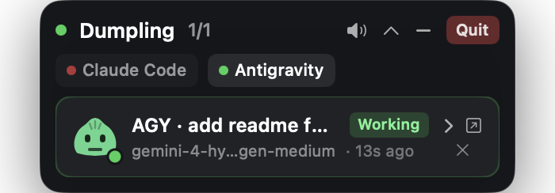

# Dumpling

Lightweight macOS floating HUD and menu bar monitor for **Claude Code** and **Antigravity** agent sessions.



## Features

- **Live Agent Overview**: Tracks active **Claude Code** and **Antigravity** sessions in real time.
- **Dumpling Mascot Avatars**: Color-coded dumpling icons with awake/sleeping expressions and status dots.
- **Inline Approvals & Prompts**: Approve/deny Claude Code permission requests or answer agent questions directly from the HUD, or jump straight to VS Code.
- **Menu Bar & Alerts**: Compact menu bar counter, collapsible pill mode, mute toggle, and macOS notifications when an agent needs input.

## Requirements

- macOS 13+
- Swift 5.9+ (Xcode or Command Line Tools)
- Node.js

## Quick Start

1. Clone the repository and start Dumpling:

   ```bash
   git clone https://github.com/allanindrajith/dumpling.git
   cd dumpling
   ./start.sh
   ```

   `start.sh` starts the local daemon on `http://127.0.0.1:47821`, builds the Swift HUD app if needed, and launches it.

2. *(Optional)* Install Claude Code hooks so Claude Code sessions & permission prompts appear in Dumpling:

   ```bash
   node scripts/install-hooks.mjs
   ```

   This backs up `~/.claude/settings.json` and registers `PreToolUse`, `PostToolUse`, `PermissionRequest`, and `Stop` hooks pointing to `hooks/claude-hook.mjs`.

## Configuration

| Variable | Default | Description |
| --- | --- | --- |
| `DUMPLING_PORT` | `47821` | Port used by `daemon/server.mjs` and `hooks/claude-hook.mjs` |
| `DUMPLING_DAEMON_PATH` | *(auto-detected)* | Custom path to `daemon/server.mjs` for the Swift HUD |

## Project Structure

- `hud-app/` — Native macOS SwiftUI floating panel & menu bar app (`Sources/Dumpling/`)
- `daemon/server.mjs` — Local HTTP/SSE daemon aggregating Claude Code hooks and Antigravity sessions
- `hooks/claude-hook.mjs` — Claude Code hook bridge forwarding events to the daemon
- `scripts/install-hooks.mjs` — Helper to register hooks in `~/.claude/settings.json`
- `start.sh` — Launches the daemon and builds/runs the HUD app

## Contributing

Contributions are welcome! Please read [CONTRIBUTING.md](CONTRIBUTING.md) and follow our [Code of Conduct](CODE_OF_CONDUCT.md) when opening issues or pull requests.

## License

This project is licensed under the [MIT License](LICENSE).
